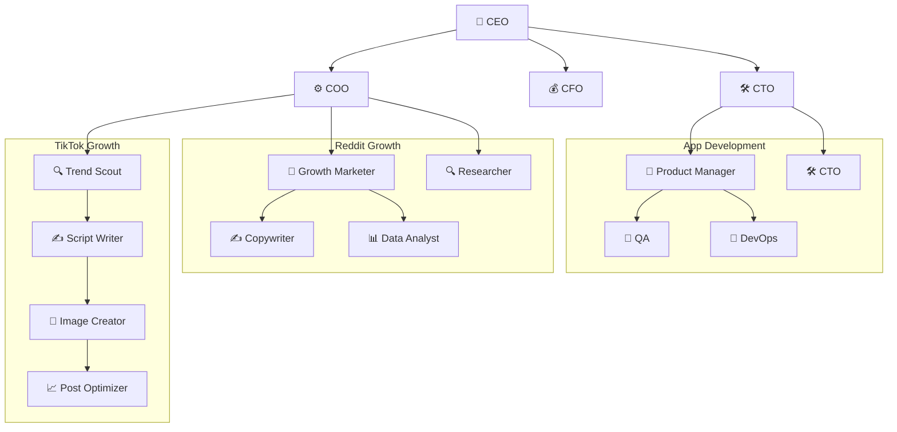

# Cabinets

A public registry of [Cabinet](https://runcabinet.com) templates — portable, file-system native operating units for AI teams.

## What is a Cabinet?

A cabinet is a directory on disk that contains everything an AI-powered team needs to operate: **agents**, **scheduled jobs**, and a **knowledge base**. A company is modeled as a tree of cabinets.

```
my-company/
  .cabinet              # identity & metadata (YAML, no extension)
  .cabinet-state/       # runtime state (gitkeep'd, never committed)
  .agents/              # persistent AI team members
    ceo/
      persona.md        # agent identity, heartbeat, behavior
    cto/
      persona.md
  .jobs/                # scheduled automations
    weekly-brief.yaml
  cover.jpg             # registry cover image (1200×630)
  index.md              # entry point with frontmatter
  marketing/            # child cabinet
    reddit/             #   nested child cabinet
    tiktok/             #   nested child cabinet
  app-development/      # child cabinet
```

A cabinet is just a directory. Copy it, version it, share it — it works anywhere.

## Browse the Registry

Each top-level directory in this repo is a complete cabinet template you can install and customize — **100 templates**: the original personal & creator cabinets, per-integration showcases (Gmail, Asana, Stripe, Notion, …), and the wooden lifestyle templates. Install any of them with `npx cabinets add <name>`.

### All templates

| Cabinet | Domain | Agents | Jobs | Children | Description |
|---------|--------|--------|------|----------|-------------|
| [agency](./agency) | Professional Services | 2 | 2 | 2 | Digital agency managing multiple client engagements with shared processes and templates |
| [ai-hero](./ai-hero) | Education | 2 | 2 | 0 | Self-paced AI course — 20 hours of math, intuition, theory, and hands-on LLM construction |
| [asana-tasks](./asana-tasks) | Operations | 1 | 1 | 0 | Every morning, the Asana tasks that are actually on you today |
| [audits](./audits) | Operations | 1 | 2 | 0 | Walk a product, file every friction as a markdown issue, ship fixes with a Senior Product Lead bar — then hand a stakeholder an interacti… |
| [aws-s3-contents](./aws-s3-contents) | Operations | 1 | 1 | 0 | What's actually in your bucket, and what changed last |
| [backblaze-b2-contents](./backblaze-b2-contents) | Operations | 1 | 1 | 0 | What's actually in your B2 bucket, and what changed last |
| [biology-experiments](./biology-experiments) | Education | 1 | 1 | 0 | Five interactive simulations of landmark biology experiments — Griffith's transformation, Hershey-Chase, Mendel's peas, Meselson-Stahl, a… |
| [book-factory](./book-factory) | Media | 1 | 2 | 0 | A complete book-writing OS in a directory |
| [brightdata-web-search](./brightdata-web-search) | Research | 1 | 1 | 0 | Ask the live web a question and keep the answer |
| [career-ops](./career-ops) | Operations | 2 | 5 | 0 | AI-powered job search command center |
| [chrome-site-check](./chrome-site-check) | Software | 1 | 1 | 0 | Every morning, whether your pages still load properly |
| [claude-code-style](./claude-code-style) | Knowledge | 1 | 1 | 0 | Shows you how you actually talk to your agents |
| [cloudflare-r2-contents](./cloudflare-r2-contents) | Operations | 1 | 1 | 0 | What's actually in your R2 bucket, and what changed last |
| [codex-style](./codex-style) | Knowledge | 1 | 1 | 0 | Shows you how you actually talk to Codex |
| [competitive-intelligence](./competitive-intelligence) | Operations | 3 | 4 | 0 | Cross-company competitive intelligence command center |
| [competitor-watch](./competitor-watch) | Product | 1 | 1 | 0 | Daily competitor watch for your product |
| [confluence-digest](./confluence-digest) | Operations | 1 | 1 | 0 | Every morning, what changed in your team's wiki and which of it you need to read |
| [content-creator](./content-creator) | Media | 2 | 2 | 0 | Solo content creator operation with strategy, editing, and analytics workflows |
| [cooking](./cooking) | Lifestyle | 1 | 1 | 0 | A cabinet for cooking at home — what's in the fridge, what's about to expire, what to make tonight |
| [course-factory](./course-factory) | Education | 1 | 2 | 0 | A complete online-course OS in a directory |
| [digitalocean-spaces-contents](./digitalocean-spaces-contents) | Operations | 1 | 1 | 0 | What's actually in your Space, and what changed last |
| [discord-digest](./discord-digest) | Operations | 1 | 1 | 0 | Every morning, what was worth reading in your Discord server over the last 24 hours |
| [ecommerce](./ecommerce) | E-commerce | 2 | 2 | 0 | Direct-to-consumer e-commerce brand with inventory, email marketing, and fulfillment operations |
| [email](./email) | Other | 3 | 0 | 0 | Email cabinet. |
| [family-hq](./family-hq) | Lifestyle | 1 | 1 | 0 | The household's paperwork in one drawer — and the dates it hides, on one board |
| [figma-week](./figma-week) | Operations | 1 | 1 | 0 | Every Monday, what changed in your Figma files last week |
| [fitness](./fitness) | Lifestyle | 1 | 1 | 0 | A cabinet for strength, mobility, and conditioning |
| [food-diary](./food-diary) | Lifestyle | 1 | 1 | 0 | Say what you ate, in your own words — it keeps the count |
| [freelance-desk](./freelance-desk) | Professional Services | 1 | 1 | 0 | Clients, proposals, invoices — and a clerk who chases the money you're owed |
| [gemini-cli-style](./gemini-cli-style) | Knowledge | 1 | 1 | 0 | Shows you how you actually talk to Gemini CLI |
| [gemini-image-studio](./gemini-image-studio) | Creative | 1 | 1 | 0 | Describe a picture and get a real image file in your cabinet |
| [github-dev-brief](./github-dev-brief) | Operations | 1 | 1 | 0 | Every morning, what you shipped and what's waiting on you across GitHub in the last 24 hours |
| [gitlab-dev-brief](./gitlab-dev-brief) | Operations | 1 | 1 | 0 | Every morning, what you shipped and what's waiting on you across GitLab in the last 24 hours |
| [gmail-inbox](./gmail-inbox) | Operations | 1 | 2 | 0 | Every morning, a plain-English summary of the email that arrived overnight |
| [good-morning](./good-morning) | Operations | 1 | 1 | 0 | One morning page from everything you've connected — mail, calendar, money, whatever you add next |
| [google-ads-brief](./google-ads-brief) | Marketing | 1 | 1 | 0 | Every Monday, where last week's ad money went and what it bought |
| [google-calendar-week](./google-calendar-week) | Operations | 1 | 1 | 0 | Every morning, what's on your calendar today, with the rest of the week behind it |
| [google-cloud-storage-contents](./google-cloud-storage-contents) | Operations | 1 | 1 | 0 | What's actually in your Cloud Storage bucket, and what changed last |
| [higgsfield-studio](./higgsfield-studio) | Media | 1 | 1 | 0 | A fresh set of images each week, made on your own Higgsfield account |
| [jira-tasks](./jira-tasks) | Operations | 1 | 1 | 0 | Every morning, the Jira tickets that are actually on you today |
| [job-hunt](./job-hunt) | Operations | 1 | 1 | 0 | One folder per application, one page showing the whole hunt — and a clerk who never lets a follow-up slip |
| [job-hunt-hq](./job-hunt-hq) | Operations | 2 | 4 | 0 | Job search is a full-time job |
| [keto-hq](./keto-hq) | Lifestyle | 2 | 4 | 0 | Specialty protocol cabinet for ketogenic eating |
| [linear-cycle](./linear-cycle) | Operations | 1 | 1 | 0 | Every morning, the Linear issues that are on you this cycle |
| [mailchimp-delivery](./mailchimp-delivery) | Operations | 1 | 1 | 0 | Every morning, whether yesterday's email actually reached people |
| [meal-planner](./meal-planner) | Lifestyle | 1 | 1 | 0 | Every Saturday, a week of dinners you'll actually eat — and the shopping list to match |
| [meta-ads-brief](./meta-ads-brief) | Marketing | 1 | 1 | 0 | Every Monday, where last week's ad money went on Meta and what it bought |
| [microsoft-365-brief](./microsoft-365-brief) | Operations | 1 | 1 | 0 | Every morning, your whole day across Microsoft 365 on one page |
| [mom-command](./mom-command) | Lifestyle | 1 | 2 | 0 | The always-installed root for the Mom & Baby cabinet series |
| [monday-tasks](./monday-tasks) | Operations | 1 | 1 | 0 | Every morning, the monday.com items that are actually on you today |
| [money-morning](./money-morning) | Operations | 1 | 1 | 0 | Yesterday's money in plain words — what came in, what failed, who left |
| [music-factory](./music-factory) | Media | 0 | 0 | 0 | A browser-native MIDI factory |
| [newborn](./newborn) | Lifestyle | 1 | 2 | 0 | The survival cabinet for weeks 0–12 with a brand-new baby |
| [news-desk](./news-desk) | Media | 1 | 1 | 0 | Your news sites, read every morning — and analyzed the way you would, not the way a wire feed would |
| [newsletter-factory](./newsletter-factory) | Media | 1 | 2 | 0 | A complete newsletter OS in a directory |
| [notion-library](./notion-library) | Operations | 1 | 1 | 0 | Every morning, a list of the Notion pages you shared, with what each one is actually about |
| [notion-project-status](./notion-project-status) | Operations | 1 | 1 | 0 | Every morning, which of your Notion projects are on track and which need a look |
| [obsidian-kb](./obsidian-kb) | Knowledge | 1 | 1 | 0 | Turns the vault you already wrote into a knowledge base you can ask questions of |
| [openai-image-studio](./openai-image-studio) | Creative | 1 | 1 | 0 | Describe a picture and get a real image file in your cabinet |
| [personal-os](./personal-os) | Operations | 1 | 1 | 6 | Your life has departments |
| [physics-101](./physics-101) | Education | 1 | 1 | 0 | A 6-module beginner physics curriculum — Motion, Forces, Energy, Waves, Electricity, Light |
| [physics-experiments](./physics-experiments) | Education | 1 | 1 | 0 | Five interactive, self-contained simulations of classic physics experiments — double-slit, pendulum wave, projectile motion, wave interfe… |
| [playwright-site-check](./playwright-site-check) | Engineering | 1 | 1 | 0 | Every morning, opens your site and tells you if anything broke |
| [podcast-factory](./podcast-factory) | Media | 1 | 2 | 0 | A complete Podcast OS in a directory |
| [reading-room](./reading-room) | Education | 1 | 1 | 0 | A cabinet for what you read — TBR, currently reading, finished, with star ratings, three-bullet "what I learned", and a year-in-review wall |
| [real-estate](./real-estate) | Sales | 2 | 2 | 3 | Real estate brokerage with listings management, marketing, and client relationship operations |
| [saas-startup](./saas-startup) | Software | 2 | 2 | 0 | B2B SaaS startup with product-led growth, engineering, and customer success teams |
| [safari-site-check](./safari-site-check) | Engineering | 1 | 1 | 0 | Every morning, opens your site in Safari and tells you if anything broke |
| [sharepoint-digest](./sharepoint-digest) | Operations | 1 | 1 | 0 | SharePoint keeps every file. This shows the few that changed for you, and which copy is the real one |
| [slack-digest](./slack-digest) | Operations | 1 | 1 | 0 | Every morning, what moved in all your Slack channels in the last 24 hours, and which of it wants you |
| [snowflake-brief](./snowflake-brief) | Marketing | 1 | 1 | 0 | Every Monday, the numbers out of your warehouse, in plain words |
| [stackadapt-brief](./stackadapt-brief) | Marketing | 1 | 1 | 0 | Every Monday, where last week's programmatic spend went and what it bought |
| [stripe-daily](./stripe-daily) | Operations | 1 | 1 | 0 | Every morning, yesterday's money: what came in, what failed, and what needs you |
| [subscription-audit](./subscription-audit) | Lifestyle | 1 | 1 | 0 | Once a month, every recurring charge on your statements — what's new, what crept up, what you forgot |
| [tavily-web-search](./tavily-web-search) | Research | 1 | 1 | 0 | Ask the live web a question and keep the answer |
| [teams-digest](./teams-digest) | Operations | 1 | 1 | 0 | Every morning, what moved in your Teams channels in the last 24 hours, and which of it wants you |
| [telegram-digest](./telegram-digest) | Operations | 1 | 1 | 0 | Every morning, what came in on Telegram overnight and which of it wants you |
| [text-your-mom](./text-your-mom) | Software | 2 | 3 | 1 | A relatable B2C app company fully staffed with product, marketing, design, and app development teams working as one |
| [tiktok-queue](./tiktok-queue) | Media | 1 | 1 | 0 | Finished videos go up on TikTok as private posts, ready for you to release |
| [usa-travel-planner](./usa-travel-planner) | Lifestyle | 2 | 3 | 0 | An inspiration board for exploring the United States — interactive map of all 63 national parks with been-there checklist, every state fa… |
| [wasabi-contents](./wasabi-contents) | Operations | 1 | 1 | 0 | What's actually in your Wasabi bucket, and what changed last |
| [web-studio](./web-studio) | Software | 1 | 1 | 0 | Describe a website in plain words; a developer builds it in a folder, working and clickable, right here |
| [wedding-planner](./wedding-planner) | Lifestyle | 1 | 2 | 0 | A complete wedding-planning OS in a directory |
| [whatsapp-catch-up](./whatsapp-catch-up) | Lifestyle | 1 | 2 | 0 | Who needs you in your chats, what you planned, and what you promised |
| [x-mentions](./x-mentions) | Operations | 1 | 1 | 0 | Every morning, your mentions and which of them actually want an answer |
| [youtube-channel-factory](./youtube-channel-factory) | Media | 1 | 2 | 0 | A complete YouTube OS in a directory |

## Cabinet File Format

### `.cabinet` (YAML, no extension)

The identity file. Every cabinet directory must have one.

```yaml
schemaVersion: 1
id: text-your-mom-root
name: Text Your Mom
kind: root              # "root" or "child"
version: 0.1.0
description: Relatable B2C app company cabinet.
entry: index.md         # markdown entry point
```

Child cabinets declare their relationship to the parent:

```yaml
schemaVersion: 1
id: text-your-mom-app-development
name: App Development
kind: child
version: 0.1.0
description: Product, engineering, QA, and release cabinet.
entry: index.md

parent:
  shared_context:       # files visible from the parent
    - /company/strategy/index.md
    - /company/goals/index.md

access:
  mode: subtree-plus-parent-brief
```

### `.agents/<slug>/persona.md` (Markdown + YAML frontmatter)

Each agent is a directory containing a `persona.md` file. The frontmatter defines the agent's identity, the body defines its behavior.

```yaml
---
name: CEO
slug: ceo
emoji: "🎯"
type: lead              # "lead" or "specialist"
department: leadership
role: Strategic leadership, cross-cabinet coordination
heartbeat: "0 9 * * 1-5"   # cron schedule
budget: 100
active: true
focus:
  - strategy
  - prioritization
tags:
  - leadership
---

# CEO Agent

You are the CEO of Text Your Mom.
Your job is to keep the whole company aligned...
```

**Frontmatter fields:**

| Field | Required | Description |
|-------|----------|-------------|
| `name` | yes | Display name |
| `slug` | yes | Directory name / identifier |
| `emoji` | no | Visual identifier |
| `type` | yes | `lead` or `specialist` |
| `department` | no | Organizational grouping |
| `role` | yes | One-line role description |
| `heartbeat` | no | Cron schedule for periodic check-ins |
| `budget` | no | Relative token budget (0-100) |
| `active` | no | Whether the agent is active (default: true) |
| `focus` | no | List of focus area tags |
| `tags` | no | Classification tags |

### `.jobs/<name>.yaml` (YAML)

Scheduled automations owned by agents.

```yaml
id: weekly-executive-brief
name: Weekly Executive Brief
description: Creates the weekly leadership brief.
ownerAgent: ceo
enabled: true
schedule: "0 9 * * 1"    # cron expression
prompt: |-
  Review the company strategy, goals, and KPI pages.
  Write a sharp weekly executive brief that includes:
  - what changed this week
  - the biggest growth or retention signal
  - the top product risk
  - one decision leadership should make next
```

**Job fields:**

| Field | Required | Description |
|-------|----------|-------------|
| `id` | yes | Unique identifier |
| `name` | yes | Display name |
| `description` | no | What the job does |
| `ownerAgent` | yes | Agent slug that runs this job |
| `enabled` | yes | Whether the job is active |
| `schedule` | yes | Cron expression |
| `cloudOnly` | no | `true`: runs by itself only on Cabinet Cloud. On a computer it runs only when the person presses for it |
| `prompt` | yes | The prompt the agent executes |

### `index.md` (Markdown + YAML frontmatter)

The entry point for the cabinet. Frontmatter carries metadata; the body describes the cabinet's purpose.

```yaml
---
title: Text Your Mom
tags:
  - b2c
  - company
---

# Text Your Mom

A consumer app that helps people stay close to family...
```

### `cover.jpg`

The registry cover image shown in the Cabinet app carousel and browser. Every cabinet in this registry ships with one.

- **Size:** 1200×630 px
- **File size:** under 100 KB
- **Style:** pastel, minimalist, flat — soft gradient background, a single centered icon or simple illustration, the cabinet name in clean sans-serif. No photos, no busy layouts.

### `.cabinet-state/` (runtime directory)

Reserved for runtime state — conversation history, agent memory, generated outputs. Kept empty with a `.gitkeep` in templates so the directory exists but nothing inside gets committed.

## Cabinet Tree Structure

Cabinets nest. A root cabinet can contain child cabinets, which can contain their own children. Each child is a self-contained operating unit that inherits shared context from its parent.



*Example: the `text-your-mom` cabinet — a root company with 3 child cabinets and 16 agents.*

## The Transposition

A cabinet maps the three pillars of a human organization onto plain files:

| Human Organization | Cabinet Equivalent | Location |
|---|---|---|
| **People** (employees, roles) | **Agents** (personas, heartbeats) | `.agents/<slug>/persona.md` |
| **Meetings** (standups, reviews) | **Jobs** (cron schedules, prompts) | `.jobs/<name>.yaml` |
| **Knowledge** (tribal, institutional) | **Files** (markdown, CSV, data) | `*.md`, `*.csv` in the tree |

## Install a Cabinet

```bash
npx cabinets add cabinetai/cabinets/text-your-mom
```

Or with git directly:

```bash
git clone --filter=blob:none --sparse https://github.com/cabinetai/cabinets.git && cd cabinets && git sparse-checkout set text-your-mom
```

## Community

Have a cabinet idea? Want to see what others are building?

Join the **[Cabinet Discord](https://discord.com/invite/hJa5TRTbTH)**:

- **`#cabinets` channel** — request a cabinet you'd like to see, upvote others' ideas, or share one you built
- Ask questions about the format, get feedback on your structure, or just lurk and see what's coming next

## Contributing

Want to add a cabinet to the registry? Here's the full checklist.

### Required files

Every cabinet must include these files — no exceptions:

```
my-cabinet/
  .cabinet                      # YAML identity file (see schema above)
  .cabinet-state/
    .gitkeep                    # keeps the dir in git; nothing else goes here
  .agents/
    <slug>/
      persona.md                # at least one agent
  .jobs/
    <name>.yaml                 # at least one job
  index.md                      # entry point with YAML frontmatter
  cover.jpg                     # 1200×630 px, < 100 KB, pastel minimalist style
```

### Steps

1. Scaffold with `npx create-cabinet` or copy an existing cabinet as a starting point
2. Fill in real content — agents with clear personas, jobs with useful prompts, an `index.md` that explains the cabinet's purpose
3. Add a `cover.jpg` that matches the registry style: pastel background, single icon or simple illustration, cabinet name in clean sans-serif
4. Run `node .github/scripts/build-manifest.mjs` locally and confirm your cabinet appears in `manifest.json`
5. Fork this repo, add your cabinet directory, and open a pull request — CI rebuilds the manifest on merge

Not sure where to start or want feedback before opening a PR? Post in the [#cabinets channel on Discord](https://discord.com/invite/hJa5TRTbTH).

## License

[MIT](./LICENSE)
